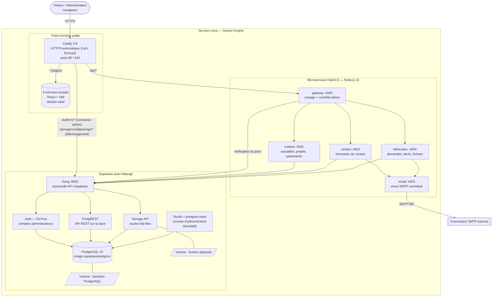
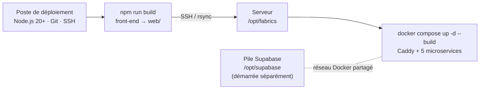

# FabriCS 2.0 — Dossier d'infrastructure serveur

| | |
|---|---|
| **Objet** | Logiciels et configuration nécessaires pour héberger FabriCS 2.0 sur un serveur Linux, base de données comprise |
| **Cible** | Un serveur unique (VPS ou machine physique), base PostgreSQL **locale**, exécutée dans Docker |
| **Public** | Personnes chargées de l'installation, de l'exploitation et de la maintenance |
| **Version** | 1.0 — novembre 2026 |

---

## Sommaire

1. [Résumé](#1-résumé)
2. [Schéma de l'architecture](#2-schéma-de-larchitecture)
3. [Matériel recommandé](#3-matériel-recommandé)
4. [Logiciels installés sur le serveur (hôte)](#4-logiciels-installés-sur-le-serveur-hôte)
5. [Logiciels exécutés dans Docker](#5-logiciels-exécutés-dans-docker)
6. [Réseau et ports](#6-réseau-et-ports)
7. [Configuration (`.env`)](#7-configuration-env)
8. [Adaptations à prévoir par rapport au déploiement actuel](#8-adaptations-à-prévoir-par-rapport-au-déploiement-actuel)
9. [Installation pas à pas](#9-installation-pas-à-pas)
10. [Sauvegardes et restauration](#10-sauvegardes-et-restauration)
11. [Sécurité](#11-sécurité)
12. [Services externes](#12-services-externes)

---

## 1. Résumé

FabriCS 2.0 se compose de trois blocs, tous exécutés dans des conteneurs Docker sur le même serveur :

1. **Caddy** — unique point d'entrée public (HTTP/HTTPS). Il sert le front-end React compilé et relaie les appels vers l'API.
2. **Les 5 microservices Node.js** — `gateway`, `content`, `contact`, `email`, `fabrication`.
3. **Supabase auto-hébergé** — PostgreSQL et les services qui l'entourent (authentification, API REST, stockage de fichiers).

> **Pourquoi Supabase auto-hébergé et pas un PostgreSQL seul ?**
> Le code n'utilise pas seulement la base de données de Supabase. Il s'appuie aussi sur :
> - **Auth (GoTrue)** pour la connexion des administrateurs (`supabase.auth.signInWithPassword`, table `auth.users`, fonction `auth.uid()` dans les règles RLS) ;
> - **PostgREST** : les microservices interrogent la base via l'API REST de Supabase (`supabase-js`), pas en SQL direct ;
> - **Storage** : les fichiers envoyés avec les demandes de fabrication sont stockés dans le bucket `fab-files`.
>
> Supabase auto-hébergé fournit tout cela avec une base **PostgreSQL locale dans Docker**. Les données ne quittent pas le serveur, et le code de l'application ne change presque pas (voir [§ 8](#8-adaptations-à-prévoir-par-rapport-au-déploiement-actuel)).

**Ce qu'il faut installer sur le serveur lui-même :** Linux, Docker Engine, Docker Compose, Git, un pare-feu et un accès SSH par clé. Tout le reste tourne dans des conteneurs. **Node.js n'est pas nécessaire sur le serveur** : le front-end est compilé sur le poste de la personne qui déploie, et les microservices ont leur propre image Node.

---

## 2. Schéma de l'architecture

### 2.1 Vue d'ensemble



### 2.2 Parcours d'une requête

| Action | Chemin |
|---|---|
| Afficher une page du site | Navigateur → Caddy → fichiers statiques `web/` |
| Lire les actualités | Navigateur → Caddy `/api/*` → gateway → content → Kong → PostgREST → PostgreSQL |
| Envoyer le formulaire de contact | … → gateway → contact → PostgreSQL, puis contact → email → SMTP |
| Déposer une demande de fabrication (avec fichier) | … → gateway → fabrication → Storage (fichier) + PostgREST (demande) → email |
| Connexion à l'espace admin | Navigateur → Caddy `/auth/v1/*` → Kong → Auth → PostgreSQL ; le jeton obtenu est ensuite contrôlé par le gateway à chaque appel `/api/admin` |
| Télécharger un fichier côté admin | Le service fabrication génère un lien signé (10 min) ; le navigateur le suit via Caddy `/storage/v1/object/sign/*` |

### 2.3 Chaîne de déploiement



---

## 3. Matériel recommandé

| Ressource | Minimum | Recommandé | Remarque |
|---|---|---|---|
| Processeur | 2 vCPU | 4 vCPU | x86_64 ou ARM64 |
| Mémoire vive | 4 Go | 8 Go | Supabase en consomme la plus grande part |
| Disque | 40 Go SSD | 80 Go SSD | Système, images Docker, base, fichiers déposés (jusqu'à 50 Mo chacun) et sauvegardes locales |
| Réseau | IPv4 publique | IPv4 + IPv6 | Nom de domaine pointant vers le serveur (enregistrement DNS A/AAAA) pour le HTTPS |

Ces valeurs sont des estimations pour une association avec un trafic modéré. À surveiller après la mise en production (`docker stats`).

---

## 4. Logiciels installés sur le serveur (hôte)

| Logiciel | Version | Rôle | Obligatoire |
|---|---|---|---|
| **Ubuntu Server** ou **Debian** | Ubuntu 24.04 LTS / Debian 12 | Système d'exploitation | Oui |
| **Docker Engine** | 24 ou plus | Exécute tous les conteneurs | Oui |
| **Docker Compose** (plugin v2) | 2.20 ou plus | Décrit et lance les piles de conteneurs (`docker compose`) | Oui |
| **OpenSSH Server** | celle de la distribution | Administration et déploiement, par clé uniquement | Oui |
| **Git** | 2.x | Récupérer la configuration Supabase auto-hébergée | Oui |
| **curl** | celle de la distribution | Installation de Docker, contrôles de santé | Oui |
| **UFW** | celle de la distribution | Pare-feu : n'ouvre que 22, 80 et 443 | Fortement recommandé |
| **unattended-upgrades** | celle de la distribution | Mises à jour de sécurité automatiques | Recommandé |
| **fail2ban** | celle de la distribution | Bloque les tentatives répétées sur SSH | Recommandé |
| **cron** | celle de la distribution | Planifie les sauvegardes | Oui (pour les sauvegardes) |

Le script `scripts/deploy.sh setup` installe déjà Docker sur le serveur avec le script officiel `get.docker.com`.

**À ne pas installer sur l'hôte :** PostgreSQL, Node.js, Caddy, Nginx. Ils tournent dans des conteneurs, et une installation en double entrerait en conflit avec les ports.

---

## 5. Logiciels exécutés dans Docker

### 5.1 Application FabriCS (dépôt `fabrics-app`)

| Conteneur | Image | Rôle | Exposé à Internet |
|---|---|---|---|
| `web` | `caddy:2.8-alpine` | Reverse proxy, HTTPS automatique, sert le front-end compilé | **Oui** (80/443) |
| `gateway` | construite depuis `services/Dockerfile` (`node:22-alpine`) | Point d'entrée de l'API `/api`, contrôle des administrateurs | Non |
| `content` | idem | Actualités, projets, partenaires, messages (admin) | Non |
| `contact` | idem | Formulaire de contact | Non |
| `fabrication` | idem | Catalogue, demandes de fabrication, devis, fichiers | Non |
| `email` | idem | Envoi SMTP centralisé ; seul service qui détient les identifiants SMTP | Non |

Fichiers concernés : `docker-compose.yml`, `docker-compose.prod.yml`, `deploy/Caddyfile`, `services/Dockerfile`.

### 5.2 Supabase auto-hébergé (dépôt officiel `supabase/supabase`, dossier `docker/`)

Seuls les composants suivants sont nécessaires à FabriCS. Les autres services du `docker-compose.yml` officiel (Realtime, Edge Functions, Analytics/Logflare, Vector, Supavisor) peuvent être retirés pour économiser de la mémoire.

| Conteneur | Image | Rôle pour FabriCS | Nécessaire |
|---|---|---|---|
| `supabase-db` | `supabase/postgres` (PostgreSQL 15) | **La base de données**, avec les schémas `auth` et `storage` attendus par les migrations | Oui |
| `supabase-kong` | `kong` | Passerelle unique vers Auth, REST et Storage, vérifie les clés API | Oui |
| `supabase-auth` | `supabase/gotrue` | Comptes et connexion des administrateurs, émission des jetons JWT | Oui |
| `supabase-rest` | `postgrest/postgrest` | API REST utilisée par les microservices (`.from('news')…`) | Oui |
| `supabase-storage` | `supabase/storage-api` | Bucket privé `fab-files`, liens signés | Oui |
| `supabase-imgproxy` | `darthsim/imgproxy` | Transformation d'images pour Storage | Facultatif |
| `supabase-meta` | `supabase/postgres-meta` | Requis par Studio | Avec Studio |
| `supabase-studio` | `supabase/studio` | Console web : tables, utilisateurs, SQL | Facultatif, **jamais exposé publiquement** |

Utilisez les versions d'images fixées dans le `docker-compose.yml` officiel au moment de l'installation, et mettez-les à jour ensemble.

### 5.3 Volumes persistants (données à sauvegarder)

| Volume | Contenu | Criticité |
|---|---|---|
| Données PostgreSQL (`volumes/db/data` dans la pile Supabase) | Toutes les données : actualités, messages, demandes, comptes admin | **Critique** |
| Fichiers Storage (`volumes/storage`) | Fichiers 3D/2D déposés avec les demandes de fabrication | **Critique** |
| `caddy_data` | Certificats HTTPS | Faible (se régénère) |
| `/opt/fabrics/.env` et `/opt/supabase/docker/.env` | Secrets et configuration | **Critique** (à conserver hors du serveur, dans un coffre de mots de passe) |

---

## 6. Réseau et ports

| Port | Service | Écoute sur | Ouvert dans le pare-feu |
|---|---|---|---|
| 22/tcp | SSH | toutes les interfaces | **Oui** (idéalement limité aux IP d'administration) |
| 80/tcp | Caddy (redirection vers HTTPS, validation Let's Encrypt) | toutes | **Oui** |
| 443/tcp + 443/udp | Caddy (HTTPS, HTTP/3) | toutes | **Oui** |
| 4000–4004 | Microservices | réseau Docker interne uniquement | Non |
| 8000 | Kong (Supabase) | réseau Docker + `127.0.0.1` | Non — accès admin par tunnel SSH |
| 5432 | PostgreSQL | réseau Docker + `127.0.0.1` | **Non, jamais** |
| 3000 | Studio | via Kong, `127.0.0.1` | Non — tunnel SSH |

> Docker contourne UFW pour les ports publiés. Il faut donc publier Kong et PostgreSQL **explicitement sur `127.0.0.1`** (par ex. `127.0.0.1:5432:5432`) et ne jamais laisser `0.0.0.0`.

Accès d'administration depuis un poste, par tunnel SSH :

```bash
ssh -L 8000:127.0.0.1:8000 -L 5432:127.0.0.1:5432 admin@serveur
# Studio : http://localhost:8000   ·   PostgreSQL : localhost:5432
```

---

## 7. Configuration (`.env`)

### 7.1 Pile Supabase (`/opt/supabase/docker/.env`)

À générer pour chaque installation, **jamais avec les valeurs d'exemple** :

| Variable | Description |
|---|---|
| `POSTGRES_PASSWORD` | Mot de passe du super-utilisateur PostgreSQL |
| `JWT_SECRET` | Secret de signature des jetons (≥ 32 caractères) |
| `ANON_KEY` | Clé publique, JWT signé avec `JWT_SECRET` (rôle `anon`) |
| `SERVICE_ROLE_KEY` | Clé privée, JWT signé avec `JWT_SECRET` (rôle `service_role`) |
| `DASHBOARD_USERNAME` / `DASHBOARD_PASSWORD` | Accès à Studio |
| `SITE_URL` / `API_EXTERNAL_URL` | `https://<domaine>` |
| `DISABLE_SIGNUP` | `true` : seuls des administrateurs créés à la main peuvent se connecter |

La documentation Supabase (*Self-Hosting with Docker*) fournit un générateur pour `ANON_KEY` et `SERVICE_ROLE_KEY`.

### 7.2 Application FabriCS (`/opt/fabrics/.env`, issu de `.env.production`)

| Variable | Valeur en production | Remarque |
|---|---|---|
| `SUPABASE_URL` | `http://supabase-kong:8000` | Adresse **interne** de Kong |
| `SUPABASE_PUBLISHABLE_KEY` | `ANON_KEY` de la pile Supabase | |
| `SUPABASE_SERVICE_ROLE_KEY` | `SERVICE_ROLE_KEY` de la pile Supabase | Secret |
| `SUPABASE_PUBLIC_URL` | `https://<domaine>` | Nouvelle variable, voir [§ 8.3](#83-liens-signés-de-téléchargement) |
| `VITE_SUPABASE_URL` | `https://<domaine>` | Adresse **publique**, utilisée par le navigateur |
| `VITE_SUPABASE_PUBLISHABLE_KEY` | `ANON_KEY` | Intégrée au front-end lors de la compilation |
| `VITE_API_URL` | `https://<domaine>/api` | |
| `PUBLIC_SITE_URL` / `CORS_ORIGINS` | `https://<domaine>` | |
| `INTERNAL_TOKEN` | longue valeur aléatoire | Secret partagé entre microservices |
| `SMTP_*`, `MAIL_FROM`, `MAIL_TO` | fournisseur SMTP | Secrets, lus uniquement par le service `email` |
| `DOMAIN` | `<domaine>` | Utilisée par Caddy pour le certificat |

---

## 8. Adaptations à prévoir par rapport au déploiement actuel

Aujourd'hui, l'application utilise un projet Supabase hébergé (cloud). Le passage à une base locale demande les changements suivants. Ils sont limités et ne touchent pas la logique métier.

### 8.1 Réseau Docker partagé

Les deux piles (FabriCS et Supabase) sont lancées séparément. Elles doivent partager un réseau Docker pour que les microservices joignent `supabase-kong` et que Caddy relaie vers Kong :

```bash
docker network create fabrics_net
```

Puis déclarer ce réseau comme `external` dans les deux fichiers `docker-compose`, et y rattacher `web`, les 5 microservices et `supabase-kong`.

### 8.2 Routes Supabase dans Caddy

Le navigateur parle directement à Supabase Auth (connexion admin) et suit les liens signés de Storage. Il faut ajouter à `deploy/Caddyfile`, **uniquement** ces deux routes :

```caddy
handle /auth/v1/* {
	reverse_proxy supabase-kong:8000
}
handle /storage/v1/object/sign/* {
	reverse_proxy supabase-kong:8000
}
```

L'API REST (`/rest/v1`) et le reste de Storage restent inaccessibles depuis Internet.

### 8.3 Liens signés de téléchargement

`services/fabrication/src/admin.js` renvoie au navigateur le lien signé produit par Supabase. Avec `SUPABASE_URL` interne, ce lien commencerait par `http://supabase-kong:8000`, une adresse que le navigateur ne peut pas joindre. Il faut remplacer cette origine par `SUPABASE_PUBLIC_URL` avant de renvoyer le lien (une ligne de code).

### 8.4 Migrations de la base

Le schéma est versionné dans `supabase/migrations/` et doit être appliqué **uniquement par ces migrations** (pas de SQL manuel). Depuis le poste de déploiement, via le tunnel SSH du [§ 6](#6-réseau-et-ports) :

```bash
npx supabase db push --db-url "postgresql://postgres:<POSTGRES_PASSWORD>@localhost:5432/postgres"
```

Les migrations créent les tables, les règles RLS, le bucket `fab-files` et les données initiales. Elles s'appuient sur les schémas `auth` et `storage`, fournis par l'image `supabase/postgres`.

### 8.5 Script de déploiement

`scripts/deploy.sh` gère Caddy et les microservices, pas la pile Supabase. Celle-ci s'installe une fois (voir [§ 9](#9-installation-pas-à-pas)), puis se met à jour à part. On peut ensuite l'intégrer au script.

---

## 9. Installation pas à pas

| # | Étape | Où |
|---|---|---|
| 1 | Installer Ubuntu 24.04 LTS, créer un utilisateur avec `sudo`, désactiver la connexion SSH par mot de passe | Serveur |
| 2 | Pare-feu : `ufw allow 22,80,443/tcp && ufw allow 443/udp && ufw enable` | Serveur |
| 3 | Pointer le nom de domaine vers l'IP du serveur (DNS A/AAAA) | Registraire DNS |
| 4 | `bash scripts/deploy.sh setup` : installe Docker et prépare `/opt/fabrics` | Poste de déploiement |
| 5 | `docker network create fabrics_net` | Serveur |
| 6 | Cloner `supabase/supabase` (dossier `docker/`) dans `/opt/supabase`, générer le `.env` ([§ 7.1](#71-pile-supabase-optsupabasedockerenv)), retirer les services inutiles, publier Kong et PostgreSQL sur `127.0.0.1`, rattacher Kong à `fabrics_net` | Serveur |
| 7 | `docker compose up -d` dans `/opt/supabase/docker` | Serveur |
| 8 | Appliquer les migrations ([§ 8.4](#84-migrations-de-la-base)) | Poste, via tunnel SSH |
| 9 | Remplir `.env.production` ([§ 7.2](#72-application-fabrics-optfabricsenv-issu-de-envproduction)) et `deploy/deploy.env` | Poste de déploiement |
| 10 | `bash scripts/deploy.sh` : compile le front-end, envoie les fichiers, lance Caddy et les microservices, vérifie la santé | Poste de déploiement |
| 11 | Créer le premier administrateur : Studio → *Authentication* → *Add user*, puis l'ajouter à la table `public.admins` | Studio, via tunnel SSH |
| 12 | Vérifier : `https://<domaine>`, `https://<domaine>/api/health`, connexion sur `/admin`, envoi d'un formulaire de test | Navigateur |
| 13 | Mettre en place les sauvegardes ([§ 10](#10-sauvegardes-et-restauration)) et tester une restauration | Serveur |

---

## 10. Sauvegardes et restauration

| Quoi | Comment | Fréquence | Conservation |
|---|---|---|---|
| Base PostgreSQL | `docker exec supabase-db pg_dump -U postgres -Fc postgres > fabrics-$(date +%F).dump` | Quotidienne (cron, la nuit) | 7 jours + 4 semaines |
| Fichiers déposés | Archive `tar` de `volumes/storage` | Quotidienne | 7 jours + 4 semaines |
| Fichiers `.env` | Copie dans un coffre de mots de passe | À chaque modification | Permanente |
| Copie hors site | `rsync` ou `rclone` vers un autre serveur ou un stockage objet | Quotidienne | Selon la capacité |

**Restauration de la base :**

```bash
docker exec -i supabase-db pg_restore -U postgres -d postgres --clean --if-exists < fabrics-AAAA-MM-JJ.dump
```

Une sauvegarde n'est fiable que si sa restauration a été testée : à faire au moins une fois par trimestre, sur une machine de test.

---

## 11. Sécurité

- **SSH** : authentification par clé uniquement (`PasswordAuthentication no`), connexion root directe désactivée, `fail2ban` actif.
- **Pare-feu** : seuls 22, 80 et 443 sont ouverts. PostgreSQL, Kong et Studio ne sont joignables qu'en `127.0.0.1`, donc par tunnel SSH.
- **HTTPS** : certificat Let's Encrypt obtenu et renouvelé automatiquement par Caddy. En-têtes HSTS, `nosniff` et `Referrer-Policy` déjà configurés.
- **Secrets** : `.env`, `.env.production` et `deploy/deploy.env` ne sont jamais commités. Les identifiants SMTP ne sont lus que par le service `email`. `SERVICE_ROLE_KEY` reste côté serveur et n'apparaît jamais dans le front-end.
- **Base de données** : les règles RLS des migrations restent actives, et les inscriptions publiques sont désactivées (`DISABLE_SIGNUP=true`).
- **Mises à jour** : `unattended-upgrades` pour le système ; mise à jour planifiée des images Docker (Caddy, Node, Supabase), après sauvegarde.

---

## 12. Services externes

| Service | Usage | Obligatoire |
|---|---|---|
| Nom de domaine + DNS | Adresse publique et certificat HTTPS | Oui (sinon HTTP seul, par IP) |
| Fournisseur SMTP | Envoi des e-mails (formulaire de contact, suivi des demandes de fabrication) | Oui en production (sinon les e-mails n'apparaissent que dans les logs) |
| Let's Encrypt | Certificats HTTPS gratuits, géré par Caddy | Automatique |
| Stockage hors site | Copie des sauvegardes | Fortement recommandé |

Aucun service cloud Supabase n'est nécessaire : la base, l'authentification et les fichiers sont hébergés sur le serveur.
