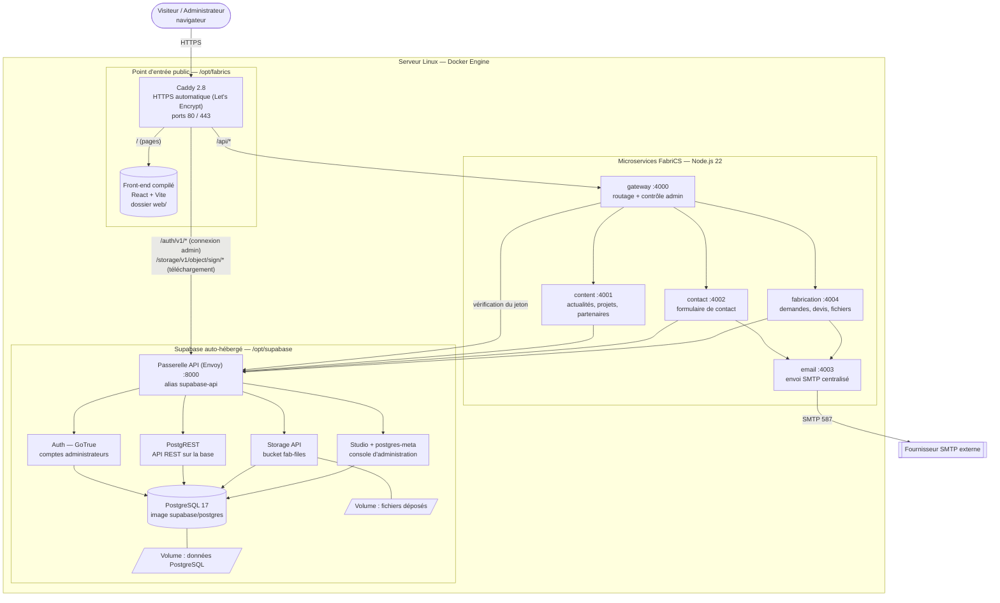
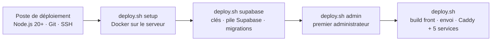

# FabriCS 2.0 — Dossier d'infrastructure serveur

| | |
|---|---|
| **Objet** | Logiciels et configuration nécessaires pour héberger FabriCS 2.0 sur un serveur Linux, base de données comprise |
| **Cible** | Un serveur unique (VPS ou machine physique), base PostgreSQL **locale**, exécutée dans Docker |
| **Public** | Personnes chargées de l'installation, de l'exploitation et de la maintenance |
| **Version** | 1.1 — novembre 2026 |

---

## Sommaire

1. [Résumé](#1-résumé)
2. [Schéma de l'architecture](#2-schéma-de-larchitecture)
3. [Matériel recommandé](#3-matériel-recommandé)
4. [Logiciels installés sur le serveur (hôte)](#4-logiciels-installés-sur-le-serveur-hôte)
5. [Logiciels exécutés dans Docker](#5-logiciels-exécutés-dans-docker)
6. [Réseau et ports](#6-réseau-et-ports)
7. [Configuration et secrets](#7-configuration-et-secrets)
8. [Intégration avec la base locale](#8-intégration-avec-la-base-locale)
9. [Installation pas à pas](#9-installation-pas-à-pas)
10. [Sauvegardes et restauration](#10-sauvegardes-et-restauration)
11. [Sécurité](#11-sécurité)
12. [Services externes](#12-services-externes)

---

## 1. Résumé

FabriCS 2.0 se compose de trois blocs, tous exécutés dans des conteneurs Docker sur le même serveur :

1. **Caddy** — unique point d'entrée public (HTTP/HTTPS). Il sert le front-end React compilé et relaie les appels vers l'API.
2. **Les 5 microservices Node.js** — `gateway`, `content`, `contact`, `email`, `fabrication`.
3. **Supabase auto-hébergé** — PostgreSQL et les services qui l'entourent (authentification, API REST, stockage de fichiers).

> **Pourquoi Supabase auto-hébergé et pas un PostgreSQL seul ?**
> Le code n'utilise pas seulement la base de données de Supabase. Il s'appuie aussi sur :
> - **Auth (GoTrue)** pour la connexion des administrateurs (`supabase.auth.signInWithPassword`, table `auth.users`, fonction `auth.uid()` dans les règles RLS) ;
> - **PostgREST** : les microservices interrogent la base via l'API REST de Supabase (`supabase-js`), pas en SQL direct ;
> - **Storage** : les fichiers envoyés avec les demandes de fabrication sont stockés dans le bucket `fab-files`.
>
> Supabase auto-hébergé fournit tout cela avec une base **PostgreSQL locale dans Docker**. Les données ne quittent pas le serveur, et la logique métier de l'application ne change pas.

**Ce qu'il faut installer sur le serveur lui-même :** Linux, Docker Engine avec Docker Compose, Git, un pare-feu et un accès SSH par clé. Tout le reste tourne dans des conteneurs. **Node.js n'est pas nécessaire sur le serveur** : le front-end est compilé sur le poste de la personne qui déploie, et les microservices ont leur propre image Node.

**Tout s'installe depuis le poste de déploiement** avec `scripts/deploy.sh` (commandes `setup`, `supabase`, `admin`, puis le déploiement lui-même), voir [§ 9](#9-installation-pas-à-pas).

---

## 2. Schéma de l'architecture

### 2.1 Vue d'ensemble



Les deux piles (FabriCS et Supabase) sont lancées séparément et communiquent par un réseau Docker partagé, `fabrics_net`.

### 2.2 Parcours d'une requête

| Action | Chemin |
|---|---|
| Afficher une page du site | Navigateur → Caddy → fichiers statiques `web/` |
| Lire les actualités | Navigateur → Caddy `/api/*` → gateway → content → passerelle Supabase → PostgREST → PostgreSQL |
| Envoyer le formulaire de contact | … → gateway → contact → PostgreSQL, puis contact → email → SMTP |
| Déposer une demande de fabrication (avec fichier) | … → gateway → fabrication → Storage (fichier) + PostgREST (demande) → email |
| Connexion à l'espace admin | Navigateur → Caddy `/auth/v1/*` → passerelle Supabase → Auth → PostgreSQL ; le jeton obtenu est ensuite contrôlé par le gateway à chaque appel `/api/admin` |
| Télécharger un fichier côté admin | Le service fabrication génère un lien signé (10 min) à l'adresse publique ; le navigateur le suit via Caddy `/storage/v1/object/sign/*` |

### 2.3 Chaîne de déploiement



---

## 3. Matériel recommandé

| Ressource | Minimum | Recommandé | Remarque |
|---|---|---|---|
| Processeur | 2 vCPU | 4 vCPU | x86_64 ou ARM64 |
| Mémoire vive | 4 Go | 8 Go | Supabase en consomme la plus grande part |
| Disque | 40 Go SSD | 80 Go SSD | Système, images Docker, base, fichiers déposés (jusqu'à 50 Mo chacun) et sauvegardes locales |
| Réseau | IPv4 publique | IPv4 + IPv6 | Nom de domaine pointant vers le serveur (enregistrement DNS A/AAAA) pour le HTTPS |

Ces valeurs sont des estimations pour une association avec un trafic modéré. À surveiller après la mise en production (`docker stats`).

---

## 4. Logiciels installés sur le serveur (hôte)

| Logiciel | Version | Rôle | Obligatoire |
|---|---|---|---|
| **Ubuntu Server** ou **Debian** | Ubuntu 24.04 LTS / Debian 12 | Système d'exploitation | Oui |
| **Docker Engine** | 24 ou plus | Exécute tous les conteneurs | Oui (installé par `deploy.sh setup`) |
| **Docker Compose** (plugin v2) | **2.24 ou plus** | Décrit et lance les piles de conteneurs ; la version 2.24 est requise pour les directives `!reset` / `!override` | Oui (installé avec Docker) |
| **OpenSSH Server** | celle de la distribution | Administration et déploiement, par clé uniquement | Oui |
| **Git** | 2.x | Récupère la configuration officielle de Supabase | Oui (installé par `deploy.sh supabase` si absent) |
| **curl** | celle de la distribution | Installation de Docker, création des administrateurs | Oui |
| **UFW** | celle de la distribution | Pare-feu : n'ouvre que 22, 80 et 443 | Fortement recommandé |
| **unattended-upgrades** | celle de la distribution | Mises à jour de sécurité automatiques | Recommandé |
| **fail2ban** | celle de la distribution | Bloque les tentatives répétées sur SSH | Recommandé |
| **cron** | celle de la distribution | Planifie les sauvegardes | Oui (pour les sauvegardes) |

**À ne pas installer sur l'hôte :** PostgreSQL, Node.js, Caddy, Nginx. Ils tournent dans des conteneurs, et une installation en double entrerait en conflit avec les ports.

**Sur le poste de déploiement** (la machine qui lance `scripts/deploy.sh`) : Bash (Linux, macOS ou Git Bash sous Windows), Node.js 20+ et un client SSH. Le CLI Supabase est utilisé via `npx`, sans installation.

---

## 5. Logiciels exécutés dans Docker

### 5.1 Application FabriCS (`/opt/fabrics`)

| Conteneur | Image | Rôle | Exposé à Internet |
|---|---|---|---|
| `web` | `caddy:2.8-alpine` | Reverse proxy, HTTPS automatique, sert le front-end compilé | **Oui** (80/443) |
| `gateway` | construite depuis `services/Dockerfile` (`node:22-alpine`) | Point d'entrée de l'API `/api`, contrôle des administrateurs | Non |
| `content` | idem | Actualités, projets, partenaires, messages (admin) | Non |
| `contact` | idem | Formulaire de contact | Non |
| `fabrication` | idem | Catalogue, demandes de fabrication, devis, fichiers | Non |
| `email` | idem | Envoi SMTP centralisé ; seul service qui détient les identifiants SMTP | Non |

Fichiers concernés : `docker-compose.yml`, `docker-compose.prod.yml`, `deploy/Caddyfile`, `services/Dockerfile`.

### 5.2 Supabase auto-hébergé (`/opt/supabase/docker`)

La configuration officielle (dépôt `supabase/supabase`, dossier `docker/`) est complétée par `deploy/supabase/docker-compose.fabrics.yml`, qui désactive les services inutiles à FabriCS :

| Service | Image | Rôle pour FabriCS | État |
|---|---|---|---|
| `db` (`supabase-db`) | `supabase/postgres` (PostgreSQL 17) | **La base de données**, avec les schémas `auth` et `storage` attendus par les migrations | Actif |
| `api-gw` (`supabase-envoy`) | `envoyproxy/envoy` | Passerelle unique vers Auth, REST, Storage et Studio ; vérifie les clés API. Alias `supabase-api` sur `fabrics_net` | Actif |
| `auth` (`supabase-auth`) | `supabase/gotrue` | Comptes et connexion des administrateurs, émission des jetons JWT | Actif |
| `rest` (`supabase-rest`) | `postgrest/postgrest` | API REST utilisée par les microservices (`.from('news')…`) | Actif |
| `storage` (`supabase-storage`) | `supabase/storage-api` | Bucket privé `fab-files`, liens signés | Actif |
| `imgproxy` (`supabase-imgproxy`) | `imgproxy` | Transformation d'images pour Storage | Actif (requis par Storage) |
| `meta` (`supabase-meta`) | `supabase/postgres-meta` | Requis par Studio | Actif |
| `studio` (`supabase-studio`) | `supabase/studio` | Console web : tables, utilisateurs, SQL | Actif, **jamais exposé publiquement** |
| `realtime`, `functions`, `supavisor` | — | Temps réel, Edge Functions, pool de connexions | **Désactivés** (non utilisés) |

Les versions des images sont celles fixées par la configuration officielle au moment de l'installation. Pour les mettre à jour : `bash scripts/deploy.sh supabase update`, après une sauvegarde.

### 5.3 Volumes persistants (données à sauvegarder)

| Emplacement | Contenu | Criticité |
|---|---|---|
| `/opt/supabase/docker/volumes/db/data` | Toutes les données : actualités, messages, demandes, comptes admin | **Critique** |
| `/opt/supabase/docker/volumes/storage` | Fichiers 3D/2D déposés avec les demandes de fabrication | **Critique** |
| Volume Docker `caddy_data` | Certificats HTTPS | Faible (se régénère) |
| `.env.supabase` et `.env.production` (poste de déploiement) | Secrets et configuration | **Critique** — à conserver dans un coffre de mots de passe |

---

## 6. Réseau et ports

| Port | Service | Écoute sur | Ouvert dans le pare-feu |
|---|---|---|---|
| 22/tcp | SSH | toutes les interfaces | **Oui** (idéalement limité aux IP d'administration) |
| 80/tcp | Caddy (redirection vers HTTPS, validation Let's Encrypt) | toutes | **Oui** |
| 443/tcp + 443/udp | Caddy (HTTPS, HTTP/3) | toutes | **Oui** |
| 4000–4004 | Microservices | réseau Docker interne uniquement | Non |
| 8000 | Passerelle Supabase (et Studio) | réseau Docker + `127.0.0.1` | Non — accès admin par tunnel SSH |
| 5432 | PostgreSQL | réseau Docker + `127.0.0.1` | **Non, jamais** |

> Docker contourne UFW pour les ports publiés. C'est pourquoi `docker-compose.fabrics.yml` publie la passerelle et PostgreSQL **uniquement sur `127.0.0.1`**.

Accès d'administration depuis un poste, par tunnel SSH :

```bash
ssh -N -L 8000:127.0.0.1:8000 -L 5432:127.0.0.1:5432 admin@serveur
# Studio : http://localhost:8000   ·   PostgreSQL : localhost:5432
```

---

## 7. Configuration et secrets

### 7.1 Pile Supabase — `.env.supabase`

Généré **automatiquement** par `bash scripts/deploy.sh supabase` sur le poste de déploiement, puis envoyé au serveur (où il complète le `.env.example` officiel). Une copie reste sur le serveur (`/opt/supabase/docker/.env.fabrics`) : si le fichier local est perdu, il est récupéré automatiquement.

| Variable | Description |
|---|---|
| `POSTGRES_PASSWORD` | Mot de passe de PostgreSQL. **Ne jamais le modifier** après la première installation |
| `JWT_SECRET` | Secret de signature des jetons |
| `ANON_KEY` / `SERVICE_ROLE_KEY` | Clés API (JWT signés avec `JWT_SECRET`) : publique et privée |
| `DASHBOARD_USERNAME` / `DASHBOARD_PASSWORD` | Accès à Studio |
| `SECRET_KEY_BASE`, `VAULT_ENC_KEY`, `PG_META_CRYPTO_KEY`, … | Clés internes des services Supabase |
| `SITE_URL`, `SUPABASE_PUBLIC_URL`, `API_EXTERNAL_URL` | Dérivées de `DOMAIN` (`deploy/deploy.env`) |
| `DISABLE_SIGNUP=true` | Aucune inscription publique : seuls les administrateurs créés par `deploy.sh admin` existent |

### 7.2 Application FabriCS — `.env.production`

Les variables Supabase sont **remplies automatiquement** par `deploy.sh supabase` :

| Variable | Valeur en production | Remarque |
|---|---|---|
| `SUPABASE_URL` | `http://supabase-api:8000` | Adresse **interne** de la passerelle Supabase |
| `SUPABASE_PUBLIC_URL` | `https://<domaine>` | Adresse publique, utilisée pour les liens de téléchargement |
| `SUPABASE_PUBLISHABLE_KEY` | `ANON_KEY` | |
| `SUPABASE_SERVICE_ROLE_KEY` | `SERVICE_ROLE_KEY` | Secret |
| `VITE_SUPABASE_URL` | `https://<domaine>` | Adresse publique, utilisée par le navigateur pour la connexion admin |
| `VITE_SUPABASE_PUBLISHABLE_KEY` | `ANON_KEY` | Intégrée au front-end lors de la compilation |

À vérifier ou compléter à la main :

| Variable | Valeur en production | Remarque |
|---|---|---|
| `VITE_API_URL` | `/api` | Rempli par `deploy.sh` |
| `PUBLIC_SITE_URL` / `CORS_ORIGINS` | `https://<domaine>` | Rempli par `deploy.sh` |
| `INTERNAL_TOKEN` | longue valeur aléatoire | Secret partagé entre microservices |
| `SMTP_*`, `MAIL_FROM`, `MAIL_TO` | fournisseur SMTP | Secrets, lus uniquement par le service `email` |
| `DOMAIN` | `<domaine>` | Utilisée par Caddy pour le certificat |

---

## 8. Intégration avec la base locale

Ce qui a été mis en place pour remplacer le projet Supabase hébergé (cloud) par la base locale :

| Sujet | Mise en œuvre | Fichier |
|---|---|---|
| Réseau partagé | Réseau Docker externe `fabrics_net`, créé par `deploy.sh`. Caddy, gateway, content, contact et fabrication y sont rattachés, ainsi que la passerelle Supabase (alias `supabase-api`) | `docker-compose.prod.yml`, `deploy/supabase/docker-compose.fabrics.yml` |
| Routes publiques Supabase | Caddy relaie **uniquement** `/auth/v1/*` (connexion admin) et `/storage/v1/object/sign/*` (liens signés). L'API REST et le reste de Storage ne sont pas joignables depuis Internet | `deploy/Caddyfile` |
| Liens de téléchargement | Les liens signés générés avec l'adresse interne sont réécrits vers `SUPABASE_PUBLIC_URL` avant d'être envoyés au navigateur | `packages/shared/src/index.js` (`toPublicSupabaseUrl`), `services/fabrication/src/admin.js` |
| Pile Supabase | Récupération de la configuration officielle, génération des clés, services inutiles désactivés, ports limités à `127.0.0.1` | `scripts/deploy.sh supabase`, `deploy/supabase/docker-compose.fabrics.yml` |
| Migrations | Appliquées **uniquement** depuis `supabase/migrations/` avec le CLI Supabase (`supabase db push`), via un tunnel SSH | `scripts/deploy.sh migrate` |
| Administrateurs | Compte créé via l'API d'administration d'Auth, puis ajouté à `public.admins` ; le mot de passe est saisi dans le terminal et ne passe jamais en ligne de commande | `scripts/deploy.sh admin` |

En développement local (`./run.sh`, `./fabrics start`), rien ne change : l'application continue d'utiliser le projet Supabase défini dans `.env`.

---

## 9. Installation pas à pas

Toutes les commandes `bash scripts/deploy.sh …` se lancent **sur le poste de déploiement**, à la racine du dépôt.

| # | Étape | Commande / action |
|---|---|---|
| 1 | Installer Ubuntu 24.04 LTS, créer un utilisateur avec `sudo`, autoriser votre clé SSH, désactiver la connexion SSH par mot de passe | Sur le serveur |
| 2 | Pare-feu | `sudo ufw allow 22,80,443/tcp && sudo ufw allow 443/udp && sudo ufw enable` (sur le serveur) |
| 3 | Pointer le nom de domaine vers l'IP du serveur | Enregistrement DNS A/AAAA |
| 4 | Configurer le déploiement (hôte, utilisateur, domaine) | `cp deploy/deploy.env.example deploy/deploy.env` puis l'éditer |
| 5 | Installer Docker sur le serveur | `bash scripts/deploy.sh setup` |
| 6 | Installer la base locale : clés, pile Supabase, migrations, `.env.production` | `bash scripts/deploy.sh supabase` |
| 7 | Compléter `.env.production` (SMTP, `MAIL_FROM`, `MAIL_TO`) | Éditeur de texte |
| 8 | Créer le premier administrateur | `bash scripts/deploy.sh admin vous@exemple.org` |
| 9 | Déployer l'application | `bash scripts/deploy.sh` |
| 10 | Vérifier : `https://<domaine>`, `https://<domaine>/api/health`, connexion sur `/admin`, envoi d'un formulaire de test | Navigateur |
| 11 | Mettre en place les sauvegardes et tester une restauration | [§ 10](#10-sauvegardes-et-restauration) |

Ensuite, au quotidien :

| Besoin | Commande |
|---|---|
| Publier une nouvelle version du code | `bash scripts/deploy.sh` |
| Appliquer une nouvelle migration | `bash scripts/deploy.sh migrate` |
| Ajouter un administrateur | `bash scripts/deploy.sh admin email@exemple.org` |
| Mettre à jour Supabase | `bash scripts/deploy.sh supabase update` (après sauvegarde) |
| État, journaux, arrêt, shell | `bash scripts/deploy.sh status` · `logs [service]` · `down` · `ssh` |

---

## 10. Sauvegardes et restauration

| Quoi | Comment (sur le serveur) | Fréquence | Conservation |
|---|---|---|---|
| Base PostgreSQL | voir la commande ci-dessous | Quotidienne (cron, la nuit) | 7 jours + 4 semaines |
| Fichiers déposés | `tar -czf storage-$(date +%F).tgz -C /opt/supabase/docker/volumes storage` | Quotidienne | 7 jours + 4 semaines |
| `.env.supabase`, `.env.production` | Copie dans un coffre de mots de passe | À chaque modification | Permanente |
| Copie hors site | `rsync` ou `rclone` vers un autre serveur ou un stockage objet | Quotidienne | Selon la capacité |

**Sauvegarde de la base :**

```bash
docker exec supabase-db sh -c 'PGPASSWORD="$POSTGRES_PASSWORD" pg_dump -h localhost -U postgres -Fc postgres' \
  > /var/backups/fabrics-$(date +%F).dump
```

**Restauration :**

```bash
docker exec -i supabase-db sh -c 'PGPASSWORD="$POSTGRES_PASSWORD" pg_restore -h localhost -U postgres -d postgres --clean --if-exists' \
  < /var/backups/fabrics-AAAA-MM-JJ.dump
```

Une sauvegarde n'est fiable que si sa restauration a été testée : à faire au moins une fois par trimestre, sur une machine de test.

---

## 11. Sécurité

- **SSH** : authentification par clé uniquement (`PasswordAuthentication no`), connexion root directe désactivée, `fail2ban` actif.
- **Pare-feu** : seuls 22, 80 et 443 sont ouverts. PostgreSQL, la passerelle Supabase et Studio n'écoutent que sur `127.0.0.1`, donc accessibles uniquement par tunnel SSH.
- **HTTPS** : certificat Let's Encrypt obtenu et renouvelé automatiquement par Caddy. En-têtes HSTS, `nosniff` et `Referrer-Policy` déjà configurés.
- **Surface exposée de Supabase** : seules les routes de connexion (`/auth/v1/*`) et de lien signé (`/storage/v1/object/sign/*`) passent par Caddy. Les inscriptions publiques sont désactivées.
- **Secrets** : `.env`, `.env.production`, `.env.supabase` et `deploy/deploy.env` ne sont jamais commités. Les identifiants SMTP ne sont lus que par le service `email`. `SERVICE_ROLE_KEY` reste côté serveur et n'apparaît jamais dans le front-end.
- **Base de données** : les règles RLS des migrations restent actives ; le schéma n'évolue que par les migrations versionnées.
- **Mises à jour** : `unattended-upgrades` pour le système ; mise à jour planifiée des images Docker (Caddy, Node, Supabase), après sauvegarde.

---

## 12. Services externes

| Service | Usage | Obligatoire |
|---|---|---|
| Nom de domaine + DNS | Adresse publique et certificat HTTPS | Oui (sinon HTTP seul, par IP) |
| Fournisseur SMTP | Envoi des e-mails (formulaire de contact, suivi des demandes de fabrication) | Oui en production (sinon les e-mails n'apparaissent que dans les logs) |
| Let's Encrypt | Certificats HTTPS gratuits, géré par Caddy | Automatique |
| GitHub (`supabase/supabase`) et Docker Hub / GHCR | Téléchargement de la configuration et des images lors de l'installation et des mises à jour | Oui, à l'installation |
| Stockage hors site | Copie des sauvegardes | Fortement recommandé |

Aucun service cloud Supabase n'est nécessaire : la base, l'authentification et les fichiers sont hébergés sur le serveur.
